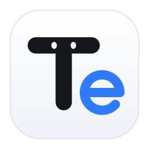
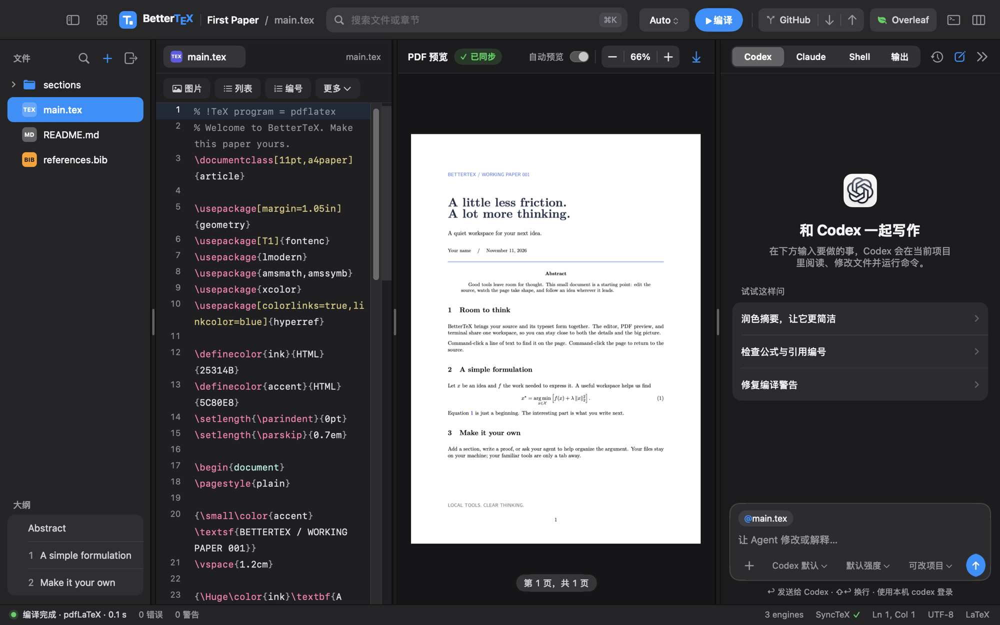
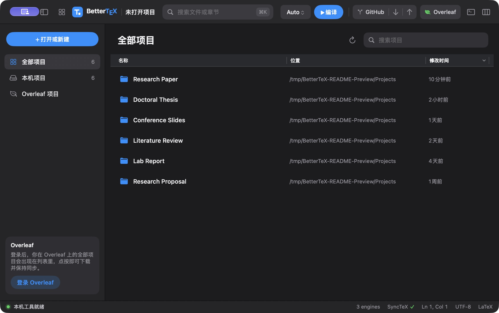
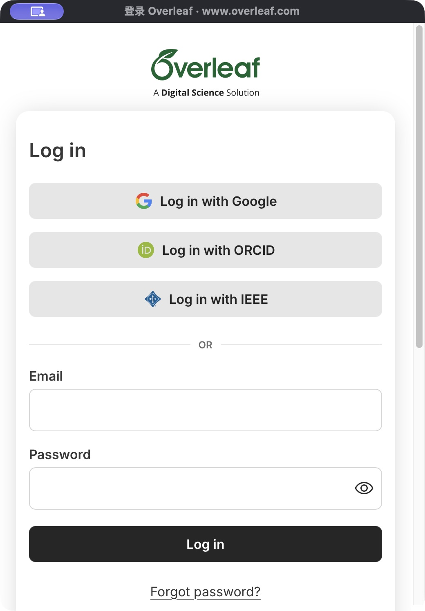

<div align="center">



# BetterTeX

**A native LaTeX workspace for macOS.**<br>
Write, compile and preview in one window — with Overleaf sync and your coding agents built in.

[](https://github.com/tangshunpu/BetterTeX/releases)
[](#install)
[](#install)
[](https://swift.org)
[](LICENSE)

[**Download**](https://github.com/tangshunpu/BetterTeX/releases) · [简体中文](README.zh-CN.md) · [User guide (中文)](docs/guide.zh-CN.md)



</div>

## Features

| | |
| --- | --- |
| ✍️ **Editor** | Syntax colouring, outline, and completion for commands, citations, labels and paths |
| ⚡ **Live preview** | Auto-compile with latexmk, pdfLaTeX, XeLaTeX or LuaLaTeX; SyncTeX in both directions |
| 🗂️ **Project home** | Local and Overleaf projects in one searchable list — click to open |
| 🍃 **Overleaf sync** | Real-time or interval sync, collaborator cursors, comments |
| 🤖 **Agents** | Native conversations with Codex and Claude Code, with diffs and session history |
| 🔀 **Git** | Pull, commit and push without leaving the window |
| 🖼️ **Quick insert** | Drop or paste an image and get a ready-made `figure` |
| 🪶 **Native** | Swift + AppKit + PDFKit. No Electron |
| 🌐 **Languages** | English and Simplified Chinese; choose System Default or a language in **BetterTeX → Settings…** (`⌘,`), then reopen the app |

## Project home & sign-in

Keep multiple projects in one searchable list, filter by local or Overleaf, and sort by name, location or last modified time. The screenshot below uses six sample projects.



Sign in to Overleaf in a dedicated window. Once signed in, your Overleaf projects appear on the project home, ready to download and open.

<p align="center">
  
</p>

## Install

1. Download the `.dmg` from [Releases](https://github.com/tangshunpu/BetterTeX/releases) and drag **BetterTeX** into Applications.
2. First launch: right-click the app and choose **Open** — the alpha is not notarized yet.

You also need a TeX distribution such as [MacTeX](https://www.tug.org/mactex/) or [TinyTeX](https://yihui.org/tinytex/). The agent panel is optional and uses the [Codex CLI](https://github.com/openai/codex) and [Claude Code](https://claude.com/claude-code) already signed in on your Mac.

## Build from source

```sh
git clone https://github.com/tangshunpu/BetterTeX.git && cd BetterTeX
./script/build_and_run.sh    # build and launch (Swift 6 / Xcode 16+)
./script/test.sh             # run the tests
```

## Good to know

- **Alpha.** Expect rough edges. The interface is currently in Simplified Chinese.
- **Your accounts stay yours.** Agents run through your own CLIs, and Overleaf keeps only a session cookie — BetterTeX never sees a password or API key.
- **Overleaf has no public API.** Sync uses the endpoints of Overleaf's own editor and may need updates when Overleaf changes.

## Contributing

Issues and pull requests are welcome — please target the `dev` branch.

## License

[MIT](LICENSE) © Shunpu Tang. Third-party notices are in [THIRD_PARTY_NOTICES.md](THIRD_PARTY_NOTICES.md).

<sub>BetterTeX is an independent project, not affiliated with Overleaf, OpenAI or Anthropic.</sub>
