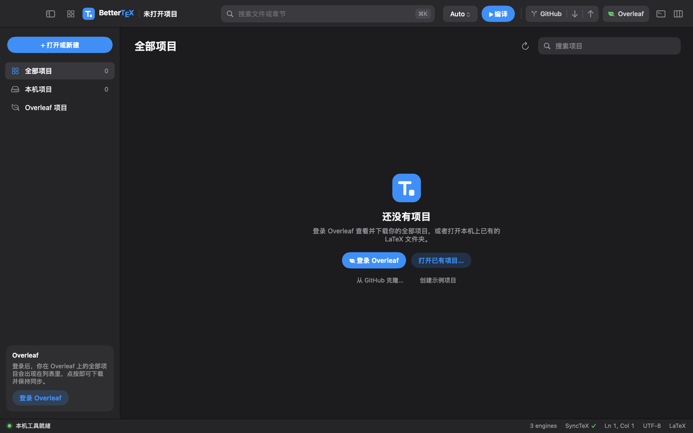

# BetterTeX

**English** · [简体中文](README.zh-CN.md)

A native, lightweight LaTeX workspace for macOS. Write, compile and preview in one window, keep your Overleaf projects in sync, and work alongside the coding agents already installed on your Mac.

Built with Swift, AppKit and PDFKit. No Electron and no background language server.


> [!NOTE]
> BetterTeX is in **alpha**. Expect rough edges and changes between releases. The interface is currently in Simplified Chinese; an English interface is not available yet.

## Features

**Write**

- LaTeX editor with syntax colouring, line numbers, current-line highlight and a document outline.
- Autocompletion for commands, environments, `\cite` keys from your `.bib` files, `\ref` labels across the project, and file paths.
- A quick-insert bar for figures, lists, equations, tables, sections and references. Drag an image into the editor, or paste a screenshot, and BetterTeX copies it into `figures/` and writes the `figure` environment for you.
- Auto-save, with detection of changes made by other programs.

**Compile and preview**

- Engines: Auto, latexmk, pdfLaTeX, XeLaTeX and LuaLaTeX. Auto reads `% !TeX program` and picks XeLaTeX when the document needs it.
- Automatic recompilation as you type, with build progress and error and warning counts.
- Side-by-side PDF preview with SyncTeX: ⌘-click the source to jump to the PDF, or the PDF to jump back.

**Projects**

- A project home page that lists your local projects and, once signed in, all of your Overleaf projects in one searchable list, sorted by last modification. Click a row to enter the project.
- Open a folder, clone from GitHub, or start from a sample paper.

**Overleaf sync**

- Download an Overleaf project, or upload a local one, and keep the two linked.
- Sync in real time, on an interval, or manually, with a three-way merge when both sides changed.
- See collaborators' cursors, read and reply to comments, and invite collaborators.

**Git**

- Pull, and commit and push with a file picker and commit message, using the Git configuration already on your Mac.

**Agents**

- Native conversations with **Codex** and **Claude Code**, shown as a timeline of replies, commands, file edits with diffs, and plans.
- Send the current file or a selection as context, choose the model and reasoning effort, pick how much the agent may change, and resume earlier sessions.
- A built-in shell and a build-output view.

## Install

1. Download the latest `.dmg` from the [Releases](https://github.com/tangshunpu/BetterTeX/releases) page.
2. Open it and drag `BetterTeX.app` onto the Applications folder next to it. A `.zip` with the same app is also provided.
3. The app is not notarized yet, so macOS blocks it on first launch. Right-click the app and choose **Open**, or allow it under **System Settings → Privacy & Security**.

**Requirements**

- macOS 13 or later, Apple Silicon.
- A TeX distribution such as [MacTeX](https://www.tug.org/mactex/), BasicTeX or [TinyTeX](https://yihui.org/tinytex/). BetterTeX does not bundle or install TeX.
- Optional: the [Codex CLI](https://github.com/openai/codex) and [Claude Code](https://claude.com/claude-code), installed and signed in, for the agent panel.

## Getting started

On first launch BetterTeX shows the project home page.



- **Sign in to Overleaf** to list every project in your account. Clicking one downloads it to `~/BetterTeX/`, links it for sync and opens it.
- **Open an existing folder** to work on a LaTeX project already on your Mac.
- **Create the sample project** to try the editor with a small paper.

Inside a project, press **⌘↩** to compile. Return to the project list at any time with **⇧⌘P**.

## How the agent panel works

BetterTeX does not talk to any model provider itself. The Codex and Claude tabs run the command-line tools you installed, in their non-interactive modes (`codex exec --json` and `claude -p --output-format stream-json`), and render their output as a conversation.

- They use whatever account each CLI is signed in to. BetterTeX never reads or stores those credentials.
- Session history is read from the logs the CLIs keep on disk. Nothing is uploaded by BetterTeX.
- The permission picker maps to each tool's own modes: Codex sandbox modes, and Claude Code permission modes.

If you redistribute a build of BetterTeX, check the terms of the respective providers for using their CLIs inside third-party software.

## How Overleaf sync works

Overleaf has no public API. BetterTeX uses the same web endpoints as Overleaf's own editor, so a change on Overleaf's side can break sync until BetterTeX is updated.

- You sign in through a web view that closes once you reach your project list. BetterTeX keeps only the session cookies and never sees your password.
- Self-hosted Overleaf instances are supported:

  ```sh
  defaults write dev.bettertex.app overleaf.host https://overleaf.example.com
  ```

## Keyboard shortcuts

| Shortcut | Action |
| --- | --- |
| ⌘↩ | Compile / stop |
| ⌘K | Search files and sections |
| ⇧⌘P | All projects |
| ⇧⌘O | Open folder |
| ⌘N | New file |
| ⌘S | Save all |
| ⌘W | Close tab |
| ⌘F | Find |
| ⇧⌘J | Jump from source to PDF |
| ⇧⌘Y | Sync with Overleaf |
| ⌘J | Fold / unfold the agent panel |
| ⇧⌘I | Insert image |
| ⌘-click | Jump between source and PDF |

## Build from source

You need Swift 6 (Xcode 16 or later). The first build downloads the pinned Swift packages.

```sh
git clone https://github.com/tangshunpu/BetterTeX.git
cd BetterTeX
./script/build_and_run.sh                         # build and launch a debug build
CONFIGURATION=release ./script/build_and_run.sh   # build and launch a release build
./script/test.sh                                  # unit and integration tests
./script/make_dmg.sh                              # package dist/BetterTeX.zip as dist/BetterTeX.dmg
```

The app bundle is written to `dist/BetterTeX.app`. Tests that need TeX are skipped when no TeX distribution is installed.

### Project layout

| Path | Contents |
| --- | --- |
| `Sources/BetterTeXCore/` | Tool discovery, compilation, SyncTeX, Git, the Overleaf client and sync logic, and the agent CLI adapters |
| `Sources/BetterTeX/` | The AppKit app: workspace, editor, PDF preview, project home page, agent panel |
| `Tests/BetterTeXCoreTests/` | Unit and integration tests |
| `script/` | Build, icon and test scripts |

## Status and limitations

- Apple Silicon only, ad-hoc signed and not notarized.
- The interface is in Simplified Chinese.
- No LSP, extensions, multi-window workspaces or full PDF annotation editing.
- Custom build chains, `minted` shell-escape and non-UTF-8 documents have no dedicated settings yet.

The Chinese README has a much more detailed description of every feature: [README.zh-CN.md](README.zh-CN.md).

## Contributing

Issues and pull requests are welcome.

- `main` holds the latest released code.
- `dev` is where development happens. Please open pull requests against `dev`.

Run `./script/test.sh` before submitting a change. Contributions are accepted under the same license as the project.

## Acknowledgements

- [SwiftTerm](https://github.com/migueldeicaza/SwiftTerm) for the terminal emulator. See [THIRD_PARTY_NOTICES.md](THIRD_PARTY_NOTICES.md).

BetterTeX is an independent project. It is not affiliated with or endorsed by Overleaf, OpenAI or Anthropic. Product names and logos belong to their respective owners.

## License

BetterTeX is released under the [MIT License](LICENSE). You may use, modify and redistribute it, including commercially, as long as the copyright notice and license text are kept.

Third-party components keep their own licenses; see [THIRD_PARTY_NOTICES.md](THIRD_PARTY_NOTICES.md).
