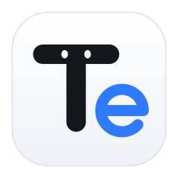
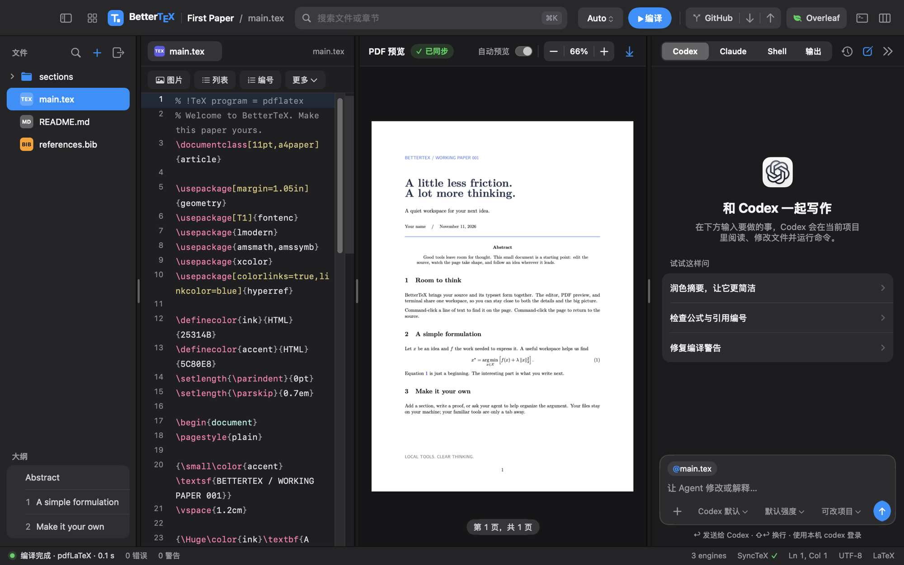
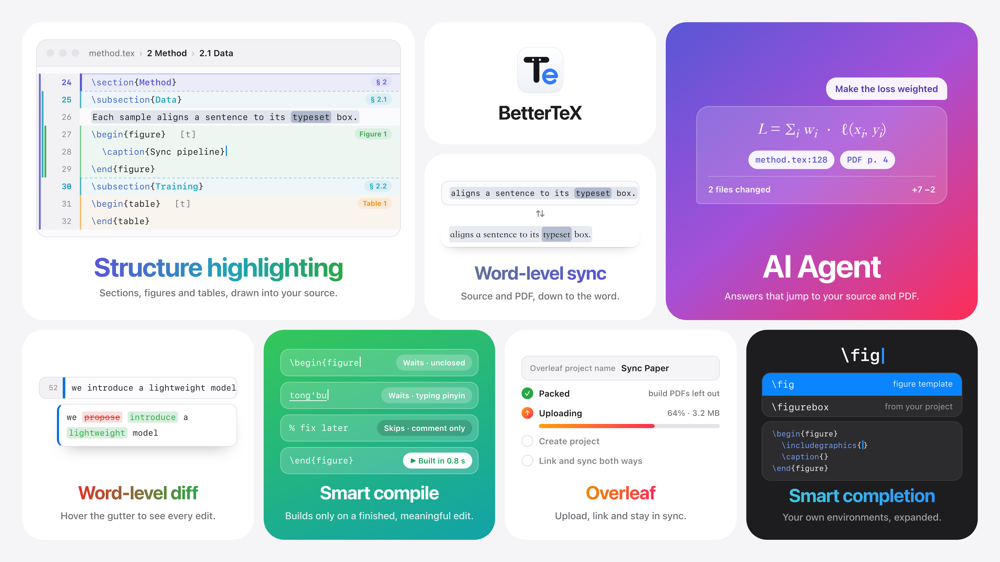
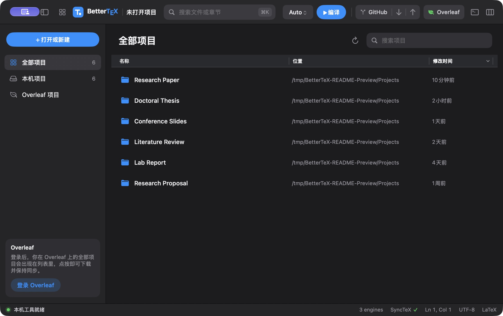
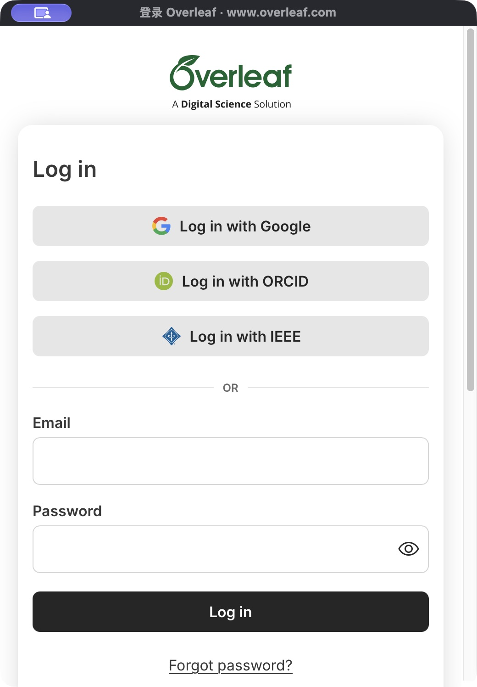

<div align="center">



# BetterTeX

**原生的 macOS LaTeX 工作区。**<br>
在一个窗口里写作、编译和预览，内置 Overleaf 同步和你的编程 Agent。<br>
源码与 PDF 词级双向跳转，安装包只有 **2.8 MB**。

[](https://github.com/tangshunpu/BetterTeX/releases)
[](#安装)
[](#安装)
[](https://swift.org)
[](https://github.com/tangshunpu/BetterTeX/releases)
[](LICENSE)

[**下载**](https://github.com/tangshunpu/BetterTeX/releases) · [English](README.md) · [使用说明](docs/guide.zh-CN.md)



</div>

## 功能



### 特色

- 🎯 **词级双向跳转。** 按住 `⌘` 点击 PDF，光标落到源码里对应的那个字符；按住 `⌘` 点击源码，PDF 上标出同一个词。构建之后又改过的内容也不会让定位跑偏。
- 🪶 **只有 2.8 MB。** 整个应用的安装包只有 2.8 MB：原生 Swift + AppKit + PDFKit，没有 Electron，也不捆绑浏览器。
- 🧭 **看得见的文档结构。** 章节、图片和表格在编辑器正文和行号栏里都有标记，文件列表下方有对应的大纲。
- 🔍 **词级 diff。** 悬停行号栏的改动条，逐词看到改了什么；点击查看完整详情。
- ⚡ **智能编译。** 实时编译会等一次有意义的编辑完成后再触发，环境没写完不会白白构建。
- 🤖 **会指路的 Agent。** Codex 和 Claude Code 的回复会排版 LaTeX，并给出可跳转的源码行和 PDF 页码。

| | |
| --- | --- |
| ✍️ **编辑器** | 语法着色、文档大纲，命令、文献、路径补全，以及自动配对 `\end` 的图片、表格和列表模板 |
| ⚡ **实时预览** | latexmk、pdfLaTeX、XeLaTeX、LuaLaTeX 自动编译；按住 `⌘` 点击即可在源码与 PDF 之间双向跳转，精确到词 |
| 🗂️ **项目主页** | 本机和 Overleaf 项目在同一张可搜索的列表里，点一下就打开 |
| 🍃 **Overleaf 同步** | 实时或定时同步，协作者光标与评论 |
| 🤖 **Agent** | Codex 和 Claude Code 的原生对话界面，带 diff 和会话历史 |
| 🔀 **Git** | 不离开窗口就能拉取、提交和推送 |
| 🖼️ **快速插入** | 拖入或粘贴图片，自动生成 `figure` 环境 |
| 🪶 **原生** | Swift + AppKit + PDFKit，没有 Electron，安装包只有 2.8 MB |
| 🌐 **界面语言** | 支持简体中文和 English，在 **BetterTeX → 设置…**（`⌘,`）中选择跟随系统或指定语言，重新打开应用后生效 |
| ⬇️ **应用更新** | GitHub Release 更新提示保留编辑焦点；主动点击后下载、验证 Ed25519 发布者签名、安装并重启，设置中可开关自动检查及预发布版本 |

## 项目主页与登录

在同一张列表中管理多个项目，按名称或位置搜索，切换本机 / Overleaf 分类，并按名称、位置或修改时间排序。下图展示了 6 个示例项目。



在独立窗口中登录 Overleaf。登录后，Overleaf 项目会出现在项目主页，点按即可下载并打开。

<p align="center">
  
</p>

## 安装

1. 在 [Releases](https://github.com/tangshunpu/BetterTeX/releases) 下载 `.dmg`，把 **BetterTeX** 拖到「应用程序」。
2. 第一次打开：右键应用选「打开」。alpha 版还没有经过 Apple 公证。

还需要本机装有 TeX 发行版，例如 [MacTeX](https://www.tug.org/mactex/) 或 [TinyTeX](https://yihui.org/tinytex/)。Agent 面板是可选的，使用你 Mac 上已登录的 [Codex CLI](https://github.com/openai/codex) 和 [Claude Code](https://claude.com/claude-code)。

**Agent 网络连接。** BetterTeX 将登录 shell 中已有的代理环境变量传给本机 CLI；没有配置代理变量时保持直连。应用不修改系统或 CLI 的代理设置，也不内置代理地址。修改 shell 配置后，在「工作区 → 本机工具」中点「重新检测」，再重试消息。

## 从源码构建

```sh
git clone https://github.com/tangshunpu/BetterTeX.git && cd BetterTeX
./script/build_and_run.sh    # 构建并启动（Swift 6 / Xcode 16+）
./script/test.sh             # 运行测试
```

## 须知

- **Alpha 版。** 还有不少粗糙的地方。
- **账号始终是你的。** Agent 通过你自己的命令行运行，Overleaf 只保留会话 cookie，BetterTeX 不接触密码或 API key。
- **Overleaf 没有公开 API。** 同步使用的是 Overleaf 网页编辑器自己的接口，Overleaf 改版后可能需要跟进。

每项功能的详细说明见 [使用说明](docs/guide.zh-CN.md)。

## 参与贡献

欢迎提 issue 和 pull request，请以 `dev` 分支为目标。

## 许可证

[MIT](LICENSE) © Shunpu Tang。第三方声明见 [THIRD_PARTY_NOTICES.md](THIRD_PARTY_NOTICES.md)。

<sub>BetterTeX 是独立项目，与 Overleaf、OpenAI、Anthropic 没有关联。</sub>
